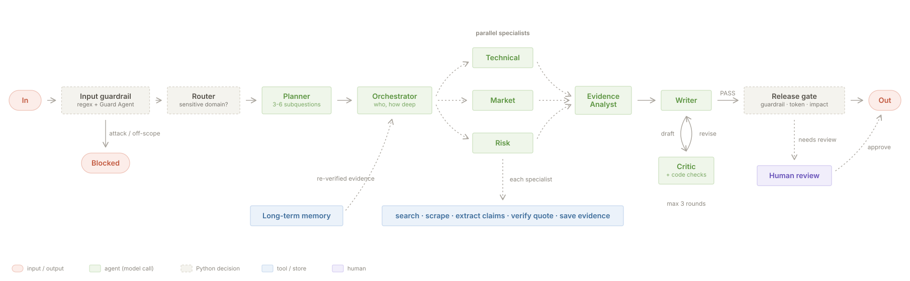

# Research & Decision Intelligence Agent

A multi-agent research system built with the **OpenAI Agents SDK**. It takes a decision question
("Should a 5-person startup use cloud LLM APIs or self-host an open-source model?"), splits it into subquestions,
researches them in parallel across real sources, verifies every quote against the page it came from, and writes a
decision report in which **every claim is traceable to a verbatim quote in a saved source**.

The model decides what to do; Python decides what is allowed. Quotes, citations, routing to human review, confidence
and release are all checked in code.



## Highlights

- **9 agents**: Guard, Planner, Orchestrator, Technical / Market / Risk researchers, Evidence Analyst, Writer, Critic
  (plus small claim-extraction and support-judge agents used inside tools).
- **11 function tools** with strict schemas; three are protected (`scrape_page`, `save_evidence`, `generate_report`).
- **All five workflow patterns**: prompt chaining, routing (code and model), parallelization, orchestrator-workers,
  evaluator-optimizer (Writer ⇄ Critic, verdict decided in code, max 3 rounds).
- **Guardrails**: regex + Guard Agent on input; SSRF-safe fetching and injection wrapping on pages; a pure-Python
  output guardrail; an approval token bound to the report's hash.
- **Human in the loop**: sensitive domains, high impact, weak corroboration or low confidence pause the run; a reviewer
  approves, rejects or requests changes, and the run resumes from the database.
- **Bonus: RAG** (hybrid BM25 + `bge-m3` embeddings) used by the Critic to find better evidence per finding.
- **Memory**: session memory (`SQLiteSession`) for follow-ups and long-term memory of verified evidence with TTLs.
- **Reliability**: model, search and embedding fallback chains; isolated worker failures; labelled partial reports.
- **Free to run**: Gemini free tier (Groq fallback), Tavily free plan, local Ollama embeddings.
- **ResearchPilot UI** (Gradio) with live pipeline progress, evidence explorer, review queue, traces and evaluation.

## Results

Measured with `python eval\run_eval.py` (details in [eval/RESULTS.md](eval/RESULTS.md), definitions in
[eval/METRICS.md](eval/METRICS.md)).

| Metric | Result | Target | How measured |
|---|---|---|---|
| Citation validity | 100% (142/142) | 100% | recorded runs |
| Grounding rate | 100% (66/66 findings) | ≥ 95% | recorded runs |
| Routing accuracy | 95% (19/20) | ≥ 90% | live |
| Input guardrail catch rate | 100% (15/15) | 100% | live |
| False positives | 0% (0/15) | ≤ 5% | live |
| Retrieval recall@5 | 91% (20/22) | ≥ 85% | offline |
| Output guardrail catch rate | 100% (5/5 planted faults) | 100% | recorded runs |
| Claim-support accuracy | 92% (11/12) | ≥ 85% | live |
| Parallel speedup | 2.38× median | reported | recorded runs |

## Setup (Windows, cmd)

Requirements: Python 3.11+, a free [Gemini API key](https://aistudio.google.com/), a free
[Tavily key](https://app.tavily.com/). Optional: a free Groq key (fallback model) and [Ollama](https://ollama.com/)
for local embeddings.

```bat
git clone https://github.com/ziad0-0Z/research-agent.git
cd research-agent
python -m venv .venv
.venv\Scripts\activate.bat
pip install -r requirements.txt
copy .env.example .env
```

Open `.env` and set `GEMINI_API_KEY` and `TAVILY_API_KEY` (optionally `GROQ_API_KEY`).
For hybrid retrieval: `ollama pull bge-m3` (without it the system falls back to BM25 and says so).

On macOS / Linux use `source .venv/bin/activate` and `cp .env.example .env`.

## Check that it works

```bat
python -m pytest -q                 :: offline, no keys needed (fake model, offline corpus)
python scripts\smoke_test.py        :: structured output, Guard, tool calling and tracing against the real model
python scripts\tools_check.py       :: runs all 11 tools once with the real model
```

## Run it

```bat
python app.py
```

Open http://127.0.0.1:7860. Choose **New research**, pick a demo scenario or type a question, and watch the
pipeline rail (square nodes = Python decides, round nodes = the model decides).

Or from the command line:

```bat
python scripts\run_research.py                          :: primary question
python scripts\run_research.py --question secondary     :: pgvector vs a dedicated vector database
python scripts\run_research.py --question "Your own decision question?"
python scripts\review.py list                           :: human review queue
python scripts\review.py approve RUN_ID --note "checked"
```

Reports are saved to `samples\<run_id>.md` with a `.json` holding the plan, workers, timeline, Critic rounds and
guardrail results.

**No network?** Set `SEARCH_MODE=offline` to research the bundled corpus in `data/corpus/`. To make no model calls at
all, record a run once with `LLM_MODE=record` and play it back with `LLM_MODE=replay`.

## The 12 demo scenarios

| # | Scenario | How to run it |
|---|---|---|
| 1 | Happy path | `run_research.py` |
| 2 | 3+ sequential steps | same run; Plan, Evidence and Report tabs show each step |
| 3 | Routing | `--question sensitive` (bank + customer financial data → review path) |
| 4 | Parallelization | primary question; the timeline shows concurrent specialists |
| 5 | Orchestrator-workers | `--question risk` (only the Risk specialist runs) |
| 6 | Evaluator rejects, then passes | `--plant-fault` (unsupported claim → REVISE → PASS) |
| 7 | Input guardrail | `--question attack` |
| 8 | Tool blocked | app: New research → "Scenario 8: protected tools refuse unsafe calls", or `tests/test_safety.py` |
| 9 | Output guardrail | `--fault fake_citation` or `--fault tampered_quote` |
| 10 | Failure recovery | `--fault search_outage` (labelled partial report) |
| 11 | Human escalation | `--question sensitive`, then the Review queue |
| 12 | Trace | Traces page, or `data/traces/*.jsonl` |

All of them are also in the **New research** scenario list in the app.

## Evaluation

```bat
python eval\run_eval.py                     :: offline + recorded metrics, no API calls
python eval\run_eval.py --live --limit 5    :: adds live routing and claim-support checks on 5 questions
python eval\run_eval.py --live              :: all 20 golden questions + 12 claim pairs (~100 model calls)
python eval\retrieval_eval.py               :: recall@5, BM25 vs hybrid
python eval\guardrail_eval.py --live        :: input guardrail catch rate and false positives
python eval\memory_eval.py                  :: memory reuse precision and false reuse
```

## Documentation

| Document | What it covers |
|---|---|
| [docs/architecture.md](docs/architecture.md) | Workflow, patterns, agents, tools, guardrails, memory, with diagrams |
| [docs/decisions.md](docs/decisions.md) | Design decisions and the reasons behind them |
| [docs/requirements.md](docs/requirements.md) | Every brief requirement → code → test → demo scenario |
| [eval/METRICS.md](eval/METRICS.md) | Metric definitions, test sets, measured results |
| [data/corpus/README.md](data/corpus/README.md) | The offline corpus and its planted test cases |

## Project layout

```
app.py                  starts the UI
src/research_agent/     the package (agents, tools, guardrails, rag, memory, workflows, store, ui)
scripts/                smoke_test, tools_check, run_research, review, memory, check_models, latency_check
eval/                   evaluation scripts, METRICS.md, generated RESULTS.md and results/*.json
data/corpus/            15 offline pages, incl. planted traps (injection, "always cheaper" blog, marketing)
data/golden/            golden sets for routing, guardrails, retrieval, memory and claim support
docs/                   architecture, decisions, requirements, diagrams
samples/                exported reports
tests/                  pytest suite (offline)
```

## Configuration

Everything is in `.env` (see `.env.example` for comments). The most useful switches:

| Variable | Values | Use |
|---|---|---|
| `LLM_PROVIDER` | `gemini` · `groq` | main provider |
| `LLM_FALLBACKS` | `provider:model,...` | tried in order on 503 / 429 / timeout |
| `LLM_MODE` | `live` · `record` · `replay` | replay = no API calls |
| `SEARCH_MODE` | `tavily` · `ddg` · `offline` | offline = bundled corpus |
| `EMBED_MODE` | `auto` · `ollama` · `gemini` · `off` | off = BM25 only |
| `MEMORY_MODE` | `on` · `read_only` · `off` | long-term memory |
| `MAX_CRITIC_ROUNDS` | default 3 (hard cap 5) | Writer ⇄ Critic loop |
| `LLM_REQUESTS_PER_MINUTE` | default 12 | free-tier protection |

## Known limitations

- Free-tier rate limits, not the code, set the run time (a full run takes a few minutes).
- Confidence describes how well the report is backed by its citations; it is not calibrated against real outcomes.
- The routing traps in the golden set were written with the keyword list in view.
- DNS rebinding between the URL check and the HTTP client's own lookup is not covered.
- Replay recordings change when memory has items; record and replay with the same database or `MEMORY_MODE=off`.
