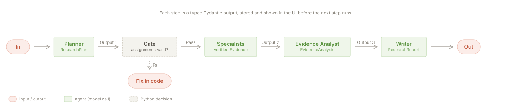
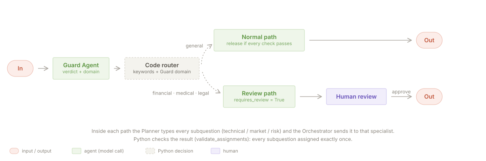
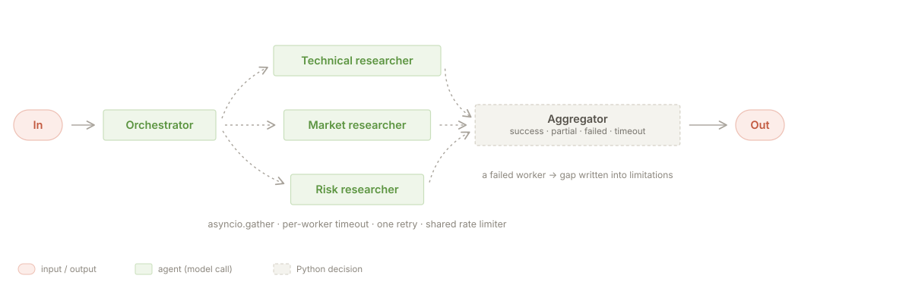
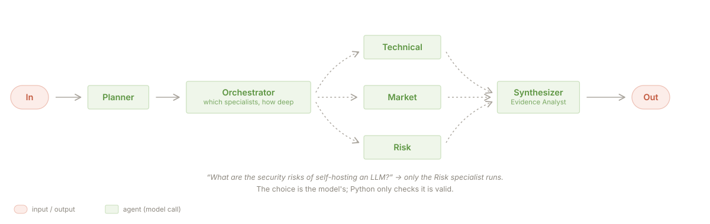
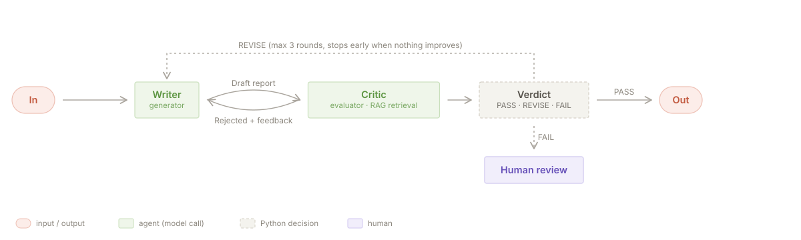
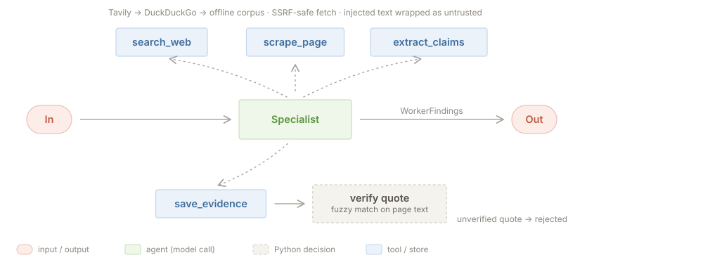
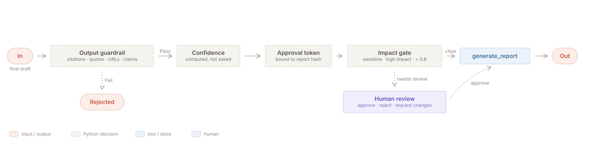
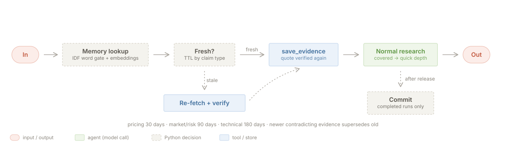

# Architecture

This document explains how the research agent is put together: the workflow, the agents, the tools,
the data that moves between them, and where Python (not the model) has the final word.

The diagrams follow the visual vocabulary of Anthropic's
[Building effective agents](https://www.anthropic.com/engineering/building-effective-agents):
pink pills are inputs and outputs, green boxes are model calls, dashed grey boxes are decisions made in Python,
blue boxes are tools or stores, purple is a human. Dashed arrows are paths that are taken only sometimes.
The SVGs are generated by `docs/diagrams/make_diagrams.py`.

## 1. The rule the design follows

> The model decides what to do. Python decides what is allowed.

Every model output is a typed Pydantic object, and every one of them is checked in code before anything depends on
it: quotes are matched against the page text, citation ids are looked up, assignments are validated, the Critic's
judgement is turned into a verdict by code, confidence is computed rather than asked for, and release goes through
deterministic gates.

## 2. The whole workflow


| # | Stage | Who decides | Output |
|---|---|---|---|
| 1 | Input guardrail: regex pre-filter, then the Guard Agent | Python + model | allow / block, domain, sensitivity |
| 2 | Router: sensitive domain (financial, medical, legal)? | Python | `RouteDecision` (review required or not) |
| 3 | Memory: related past reports (shown only) | Python | list of past runs |
| 4 | Planner | model | `ResearchPlan` (3-6 typed subquestions with search queries) |
| 5 | Orchestrator, then `validate_assignments` | model, checked by Python | `OrchestrationDecision` → `AssignmentPlan` |
| 6 | Memory reuse: remembered evidence re-verified and saved | Python | evidence ids, lower depth for covered subquestions |
| 7 | Specialists (technical / market / risk) in parallel | model + tools | `WorkerFindings` per specialist |
| 8 | Evidence Analyst | model | `EvidenceAnalysis` (agreements, contradictions, gaps) |
| 9 | Writer ⇄ Critic loop | model, verdict by Python | `ResearchReport` + Critic rounds |
| 10 | Confidence | Python | score with its parts |
| 11 | Release: output guardrail → approval token → impact gate | Python | completed / paused for review / rejected |
| 12 | Memory commit (completed runs only) | Python | stored evidence + report |

Not every question uses every stage. A narrow question can use one specialist; a blocked question stops at stage 1;
a follow-up question in the same session gives the Planner the earlier turns.

## 3. The five workflow patterns

### Prompt chaining



The question becomes a plan, the plan becomes verified evidence, the evidence becomes an analysis, and the analysis
becomes a report. Each step's output is a Pydantic model that is stored with the run and shown in the UI
(Plan and agents, Evidence, Report tabs). Between the Planner and the specialists there is a gate in code:
every subquestion must be assigned exactly once to a known specialist, and mistakes are fixed in code rather than
sent back to the model.

### Routing



Routing happens at two levels:

- **Code routing.** `workflows/router.py` looks for sensitive domains using keyword rules plus the domain the Guard
  Agent reported. Ambiguous words need a context word ("trading" alone is not finance, "court" alone is not legal).
  A sensitive question is always released through a human.
- **Model routing.** The Planner gives each subquestion a type (technical, market, risk) and the Orchestrator sends it
  to the matching specialist.

Measured: the code router alone gets 20/20 on the golden set (including 4 keyword traps); the full live path
(Guard → router → Planner → Orchestrator) gets 19/20.

### Parallelization



`workflows/parallel.py` runs the specialists with `asyncio.gather`. Each worker has its own timeout
(`WORKER_TIMEOUT_SECONDS`), one retry if it failed fast without evidence, and its failure is isolated: the
others continue, and the aggregator marks each worker `success`, `partial`, `failed` or `timeout`.
A missing specialist becomes a gap in the report's limitations, not a crash. All model calls go through one shared
rate limiter so parallel workers do not trip free-tier limits. Measured median speedup over sequential: 2.38×.

### Orchestrator-workers



The Orchestrator decides which specialists run and how deep (quick or thorough). For
"What are the security risks of self-hosting an LLM?" it uses only the Risk specialist. The three specialists come
from one factory (`agents/researchers.py`): same tools, different instructions.

### Evaluator-optimizer



`workflows/eval_loop.py`. Each round has three parts:

1. **Code checks**: cited ids exist, contradictions found by the Analyst are acknowledged, failed research is
   disclosed, subquestions are covered.
2. **Retrieval + model review**: for each finding, hybrid retrieval brings the most relevant evidence the Writer did
   not cite; the Critic judges whether each citation supports the claim and points to better evidence.
3. **Code verdict**: PASS (no blocking issue), REVISE, or FAIL. Strength rules are applied directly
   (partial support is never "strong"; "strong" needs two independent sources or one high-quality one).

The loop stops on PASS, after `MAX_CRITIC_ROUNDS` (3, hard cap 5), when two rounds report the same blocking issues,
or when the Writer fails. The best draft (fewest blocking issues) is kept. FAIL sends the report to a human.

## 4. Agents

| Agent | File | Output model | Job |
|---|---|---|---|
| Guard | `agents/guard.py` | `GuardrailVerdict` | Injection, harmful or off-scope requests; domain and sensitivity |
| Planner | `agents/planner.py` | `ResearchPlan` | 3-6 typed subquestions, search queries, success criteria |
| Orchestrator | `agents/orchestrator.py` | `OrchestrationDecision` | Which specialists, which subquestions, what depth |
| Technical / Market / Risk researcher | `agents/researchers.py` | `ResearcherOutput` | Search, read, extract and save evidence |
| Claim extractor | `agents/tool_agents.py` | `ClaimExtraction` | Claims with verbatim quotes from one page |
| Evidence Analyst | `agents/tool_agents.py` | `EvidenceAnalysis` | Agreements, contradictions, gaps |
| Support judge | `agents/tool_agents.py` | `ClaimSupportVerdict` | Does this quote support this claim? |
| Writer | `agents/writer.py` | `ResearchReport` | Report from evidence only; uncertainty goes to limitations |
| Critic | `agents/critic.py` | `CriticReview` | Unsupported claims, missing sources, ignored contradictions |

## 5. Tools



Eleven `function_tool`s in `tools/registry.py`, all with strict schemas.

| Tool | Guard in code |
|---|---|
| `search_web` | Tavily → DuckDuckGo → offline corpus; result cap, timeout, origin labelled |
| `validate_source` | Reachable, has content, domain type, date |
| `scrape_page` (protected) | Blocks localhost, private and non-public IPs in any notation, `file://`; size cap; injected text detected and wrapped as untrusted |
| `extract_claims` | Each quote fuzzy-matched against the page text |
| `save_evidence` (protected) | Rejects unknown sources, unverified quotes, duplicates |
| `score_source_quality` | Deterministic score from domain type, recency, length, injection flag |
| `compare_sources` | Runs the Evidence Analyst over saved evidence |
| `retrieve_evidence` | Hybrid BM25 + embeddings (the RAG part) |
| `validate_citation` | Evidence exists, is verified and supports the claim |
| `request_human_approval` | Persists a pending review; idempotent |
| `generate_report` (protected) | Needs an approval token bound to the report's hash |

## 6. Two grounding checks

| Check | Question | Who | Stored as |
|---|---|---|---|
| Quote verification | Is this quote really on the page? | Python (fuzzy match ≥ 0.9) | `Evidence.verified` |
| Claim support | Does the quote support the claim? | Critic / support judge | `Evidence.support` |

A real quote can still be stretched into a claim it does not support, so both are needed. A finding may only cite
evidence that is verified and judged `supported` or `partial`.

## 7. Release and human review



- **Output guardrail** (`guardrails/output.py`) never edits the report; it only passes or rejects. It re-validates the
  schema, checks every cited id exists, is verified, and that its quote still matches the stored page; rejects
  `not_supported` evidence, claims of actions no tool confirmed ("we benchmarked", "approved by a human" without an
  approved review), URLs that are not saved sources, and injected instructions.
- **Confidence** (`workflows/confidence.py`) = coverage × mean source quality × (1 − contradiction penalty) ×
  worker factor × corroboration. It measures how well the report is backed by what it cites; it is not a probability
  that the recommendation is right.
- **Approval token**: issued only after the output guardrail passes, bound to the SHA-256 of the report, kept in
  memory only. Change the report and the token is void.
- **Impact gate** (`workflows/release.py`): a human must decide if the domain is sensitive, the Critic said FAIL, the
  Guard was unavailable, impact is high, fewer than two independent sites back the evidence, page fetches failed, or
  confidence is below 0.6.
- **Review queue** (`workflows/resume.py`): approve, reject, or request changes with a note. A paused run is restored
  from the database in a new process and passes every check again with a fresh token. A report revised after a
  human's request always goes back to a human.

## 8. Memory



- **Session memory**: the SDK's `SQLiteSession` (`data/sessions.db`). Only the Planner sees earlier turns, only for
  follow-up questions; blocked questions are never recorded.
- **Long-term memory** (`memory/`): stores verified evidence, not conclusions. Only completed runs write. Reused
  evidence goes back through `save_evidence`, so the Critic and output guardrail check it like new evidence. Items have
  a time-to-live by claim type (pricing 30 days, market and risk 90, technical 180); stale ones are re-fetched and
  re-verified before reuse. Newer contradicting evidence supersedes old evidence only when the winner is clear;
  otherwise both are kept as contested. Past reports are shown as "related research" but never given to an agent,
  because a past conclusion is not evidence.

## 9. Reliability and tracing

- Model fallback chain (`llm.py`): 503, 429 or timeout moves the call to the next model in `LLM_FALLBACKS`; the busy
  model cools down for 60 s. Providers that reject tools + JSON schema in one request are skipped for those calls.
- Search fallback: Tavily → DuckDuckGo → offline corpus, labelled in the report's "Research coverage" section.
- Embedding fallback: Ollama `bge-m3` → Gemini embeddings → BM25 only.
- A crashed run is marked `failed` with the stage it failed in.
- Tracing: one `trace()` per run with named spans for every stage, stored as local JSONL (`data/traces/`) and shown
  on the Traces page; optionally exported to the OpenAI dashboard.
- Record / replay (`LLM_MODE`): record real responses once, replay them with no network for tests and demos.

## 10. Data and storage

SQLite in `data/research.db`: runs (with full state for resume), sources, evidence, reviews, memory tables.
Embedding vectors are cached in `data/cache/embeddings.db`. `data/corpus/` holds 15 synthetic pages with planted
test cases (an "always cheaper" blog post, a page with injected instructions, marketing copy) so every demo
scenario can run offline.

## 11. Code map

```
src/research_agent/
  config.py       settings from .env (load_dotenv first), code-level limits
  llm.py          Gemini / Groq through the OpenAI-compatible API, rate limiter, fallbacks, record/replay
  models.py       every structured output and internal record
  context.py      AppContext passed to tools through RunContextWrapper
  agents/         guard, planner, orchestrator, researchers, tool agents, writer, critic
  tools/          the 11 function tools and their helpers
  guardrails/     url_safety, injection, input, output, sdk (input_guardrail on the Planner)
  rag/            embeddings (with fallback and cache), hybrid retrieval (BM25 + dense, RRF)
  memory/         policy, store, matching, lookup, commit, supersede, user_context
  workflows/      pipeline, router, parallel, eval_loop, confidence, quality, release, resume, session, reliability
  store/          SQLite access
  ui/             Gradio app (ResearchPilot), components, evidence graph, trace view
  evaluation.py   metric code shared by eval/run_eval.py and the Evaluation page
```
